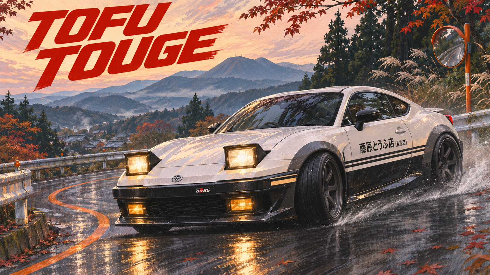
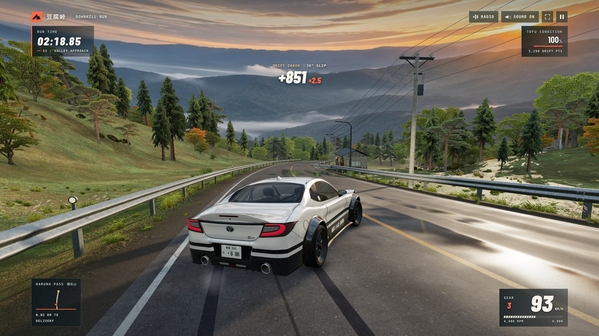
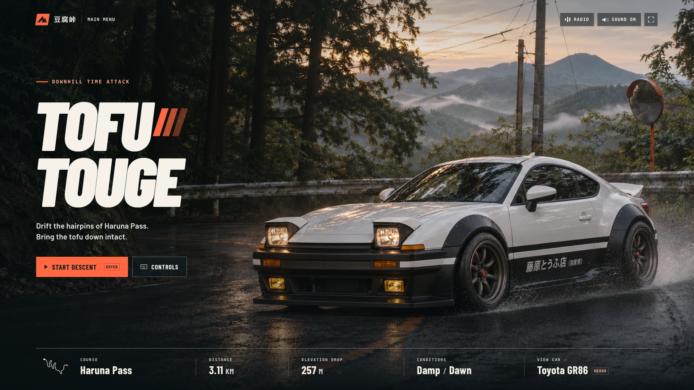
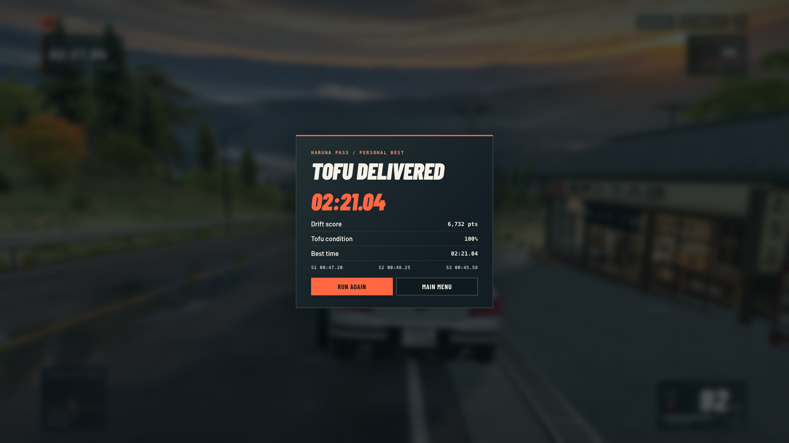

# Tofu Touge

A Three.js downhill drift game set on a fictional, Haruna-inspired pass in Gunma. Take a panda-painted Toyota GR86 down 3.11 km of wet switchbacks, dropping 257 m before the delivery at the tofu shop. The car has rear-wheel-drive arcade handling, an automatic five-speed shift map, and three driving cameras.

**[Play in your browser](https://bhaisley.github.io/tofu-touge/)** · [Download the offline game](https://github.com/bhaisley/tofu-touge/releases/download/v0.1.0/Tofu-Touge.html) · [Watch the full run](https://bhaisley.github.io/tofu-touge/docs/media/haruna-full-run.mp4)

## Promotional concept



An original illustrated poster for the Haruna Downhill release.

## Full downhill run

[](https://bhaisley.github.io/tofu-touge/docs/media/haruna-full-run.mp4)

The delivery clock stops at **02:21.04** with **6,732 drift points** and **100% tofu condition**. The peak slide reaches **40.1°**. A scripted driver used the standard analog gamepad controls for the entire run, from the starting grid through all three sectors. The stereo audio comes from the game, including the engine, tires and the radio’s transition from *Daybreak Signal* to *Kōri no Hibana*.

[Watch in your browser · 720p60](https://bhaisley.github.io/tofu-touge/docs/media/haruna-full-run.mp4) · [Download the full-resolution video · 1080p60](https://github.com/bhaisley/tofu-touge/releases/download/v0.1.0/Haruna-Full-Run.mp4) · [Repository copy](docs/media/haruna-full-run.mp4)

## Screenshots



| Cedar ridge · 40° of slip | Five hairpins · countersteering into the bend |
| --- | --- |
|  |  |
| **NEO86 · walkaround** | **Tofu delivered · all three sector splits** |
|  |  |

These screenshots come directly from the released game. [Capture details](MEDIA_PROVENANCE.json)

## Play

Open the browser edition or download **Tofu-Touge.html** and open it in a browser with WebGL enabled. The single-file edition embeds the renderer, models, art, fonts, soundtrack, and effects for offline play. [Play online](https://bhaisley.github.io/tofu-touge/) · [Download the standalone game](https://github.com/bhaisley/tofu-touge/releases/download/v0.1.0/Tofu-Touge.html)

Select **View Car** on the title screen to inspect the playable GR86. Drag or use the arrow keys to orbit, and scroll, pinch, or press + / − to zoom. The right stick rotates the view on a standard gamepad. **Back** or Escape returns to the menu. [Compare the rear and paint in game](playtest/gr86-rear-and-paint.jpg) · [Rear glass close-up](playtest/neo86-rear-glass.jpg) · [Walkaround photographs](playtest/neo86-walkaround.jpg)

Open **Radio** to audition any track and select the music for your run. The five songs play in sequence. Press **N** or **D-pad right** to skip while driving. Opening the radio mid-run pauses the car and keeps the music playing. The game remembers your selection between visits.

Watch the GR86 drift through a Haruna hairpin with **Kōri no Hibana** on the radio. The seven-second chase-camera recording includes the engine, tire screech and music as mixed by the game. [Watch the hairpin](playtest/haruna-hairpin.mp4) · [Hear the engine in isolation](playtest/ae86-engine-run.m4a)

The pass is set just after rain. Water collects between drying tire tracks, while sugi, maple and silvergrass line the bends. [Earlier wheel, glass and meadow comparison](playtest/haruna-detail-update.jpg) · [Earlier environment comparison](playtest/haruna-environment.jpg)

For the editable static edition, run the following command from this directory and open the loopback address the server prints.

```sh
python3 -m http.server 8477 --bind 127.0.0.1 --directory dist
```

Use WASD or the arrow keys to drive. Brake before a hairpin, turn in and pull Space briefly to lock the rear wheels. Release Space, feed in throttle and tap opposite steer to balance the slide. The drift readout shows your body slip angle. Straightening up banks the chain. Barrier hits cost tofu condition and break a live chain. Reaching zero condition ends the delivery. R recovers the car with a three-second penalty, C cycles cameras, M toggles sound, and Escape pauses.

The Controls screen lists bindings for standard gamepads and touchscreens. A run has three sector splits. The game keeps the best completed time and drift score in the browser's local storage when available. The pause menu has a separate music switch.

## Build and assets

The editable game lives in `dist/` and can be served by a static HTTP server. Rebuild the offline edition with `python3 tools/standalone.py`. Three.js r160.1 and the Barlow fonts ship with their licenses in `dist/vendor/` and `dist/assets/fonts/`.

The GR86 and the pass are authored in JavaScript. The car uses the second-generation Toyota coupe’s 2.575 m wheelbase and fastback roofline. Its raised rectangular lamps, graphite overfenders, front apron and eight-spoke wheels follow the Result Japan gallery and Tokyo Auto Salon photographs. The listed kit fits the first-generation 86, BRZ and FR-S. Its use on the modern GR86 is a custom game design. The right-hand-drive interior and driver’s-door tofu-shop lettering complete the Initial D homage. [NEO86 reference gallery](https://www.evasivemotorsports.com/store/product/result-japan-neo86-wide-body-kit-frp-scion-fr-s-subaru-brz-toyota-86-13-20/) · [Toyota GR86 dimensions](https://www.toyota.com/content/dam/toyota/brochures/pdf/2025/gr86_ebrochure.pdf)

The five mounted GR86 rear views guided the glass, swept C-shaped lamps, integrated ducktail and recessed plate. The center stop lamp sits under the lip. The black NEO86 lower finish carries on behind both rear wheels and wraps across the bumper. A narrow pearl stripe aligns with the side stripes above it. The lower bumper has one exhaust outlet on each side, as on the silver and red cars. View Car carries the black NEO86 exhibition plate and the downhill delivery uses the Gunma registration. Trees and sky openings reflect across the pearl body and black lacquer as the car turns. [Matched in-game rear views](playtest/gr86-rear-and-paint.jpg)

The rear glass is 1.42 m wide at its base and measures 626 mm along the centerline from roof to sill. Its lower edge sweeps aft in plan, reads almost level from directly behind and turns up at the corners. The cage diagonal clears the back of the driver’s headrest by 74 mm. The wheel tracks are 1.756 m front and 1.798 m rear. With the wheels straight, the sidewalls sit about 11 mm inside the front flare crowns and 13 mm inside the rear crowns. [Rear glass close-up](playtest/neo86-rear-glass.jpg) · [Wheel detail](playtest/haruna-detail-update.jpg)

The soundtrack was composed and rendered locally with YuE2. The radio crossfades on the Web Audio clock and keeps the current song and the next song decoded. All five tracks are included in the offline HTML. [Night Delivery production notes](sound/music/night-delivery.md) · [New tracks, scores and lyrics](sound/music/haruna-radio.md)

| Track | Style | Tempo |
| --- | --- | --- |
| [Night Delivery](dist/assets/music/night-delivery.mp3) | Arcade eurobeat | 150 BPM |
| [Cedar Afterglow](dist/assets/music/cedar-afterglow.mp3) | Flute-led Japanese jazz-hop | 92 BPM |
| [Rain on the Engawa](dist/assets/music/rain-on-the-engawa.mp3) | Electric-piano lo-fi hip-hop | 76 BPM |
| [Daybreak Signal](dist/assets/music/daybreak-signal.mp3) | Guitar-led J-pop with an original Japanese chorus | 143 BPM |
| [Kōri no Hibana](dist/assets/music/kori-no-hibana.mp3) | Japanese kawaii metal with a sung refrain and double-kick drums | 180 BPM |

Fifteen SuperCollider sounds cover the engine, tires, road noise, and event cues. The editable synthesis code is in `sound/sfx/`. [Artwork and material credits](art-direction.md)

The engine uses original synthesized exhaust recordings at 960, 2,400, 3,600 and 6,600 RPM, with separate intake and closed-throttle sounds. All six follow the same four-cylinder firing cycle through shifts. The exterior exhaust was tuned against the parked and departing car in noplansco’s mountain run. The onboard section informed the fuller low mids in bonnet view. Passing a stone retaining wall adds one short reflection on that side of the road. [Parked and pulling away at 0:43](https://www.youtube.com/watch?v=sBC2tZZuXr0&t=43s) · [Onboard at 1:22](https://www.youtube.com/watch?v=sBC2tZZuXr0&t=82s) · [Exterior pass at 1:30](https://www.youtube.com/watch?v=sBC2tZZuXr0&t=90s)

## Handling and chase cameras

The chassis runs at 120 Hz. The front and rear tires share their available grip between cornering and longitudinal force. Braking shifts load forward, power goes to the rear axle, and a short rear lock can initiate a drift. The steering and yaw assists are tuned for the pass and digital inputs. The cameras, wheels and tire trails share an interpolated pose. The wheels meet the local road triangles while the sprung body rolls and pitches under load.

Run `node tools/check-handling.cjs` to reproduce braking, throttle oversteer, a keyboard and an analog hairpin, a complete delivery, and a glancing barrier hit. Run `node tools/check-presentation.cjs` to check motion between physics ticks across several display rates and a recovery. Run `node sound/sfx/check-mix.cjs` to check tire levels, engine response, the camera perspectives and wall reflections.

With Playwright and Chromium installed, `node tools/check-radio.cjs` exercises the offline song picker, measures audible output from all five tracks, and checks crossfades, rapid skips, pause and resume, and the saved selection. Set `CHROME_BIN` to use an existing Chromium installation.

Run `node tools/check-backlight.cjs` to measure the glass and cage clearance, trace the two-tone finish behind both wheels, verify the plate mounting and check the under-spoiler stop lamp and both outer brake lights in the offline game’s two chase cameras.

## Production decisions

This build assumes one car, one fictional mountain pass, single-player delivery time attack, and accessible arcade handling. For a larger production, the decisions that change the work most are the minimum hardware and frame-rate target, intended controller or wheel support, handling reference, and number of passes, cars, rival drivers, and campaign events. A dimensioned scan or CAD model of the conversion would support a more exact exterior. Vehicle-specific recordings under load would support a future modern GR86 sound tune. Driver playtests on target hardware would help refine handling. Commercial planning should include the intended Toyota and Initial D branding permissions and review of the music model’s commercial terms.
