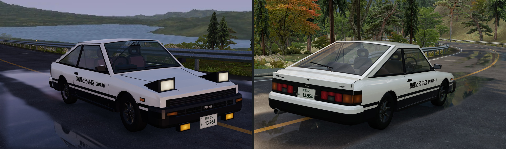
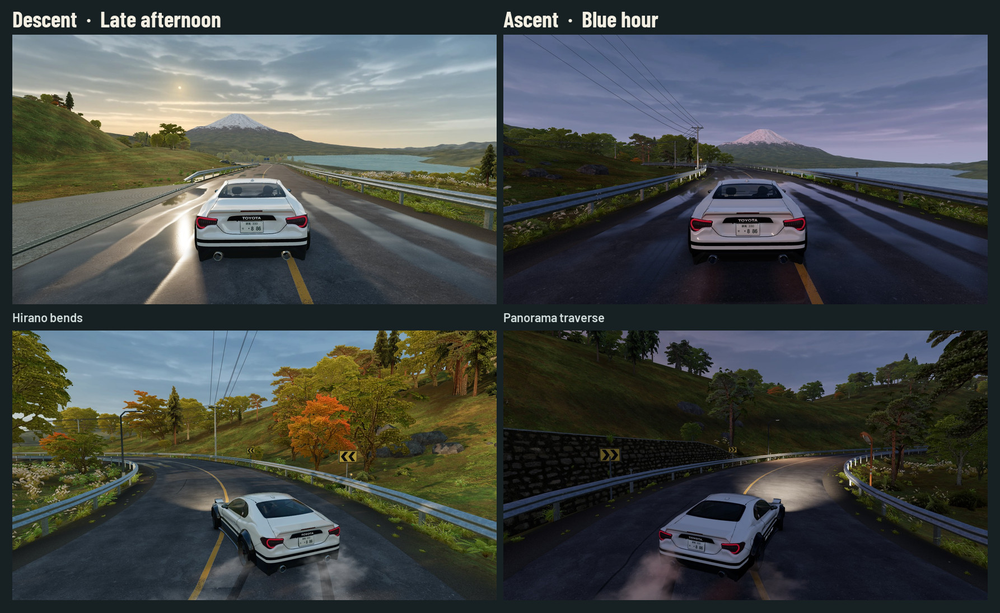
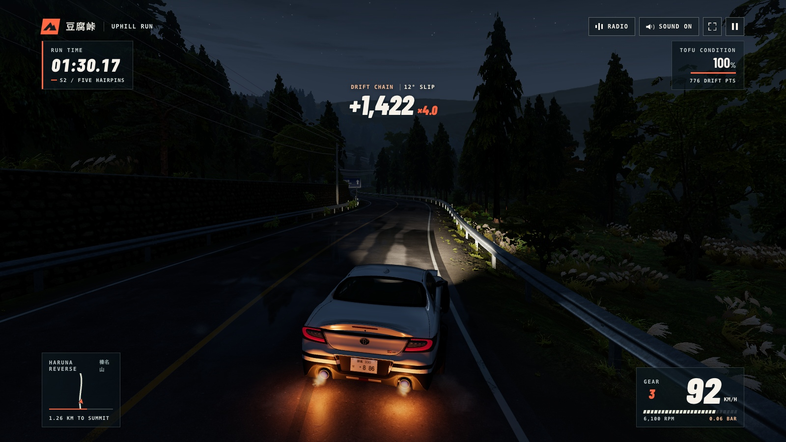
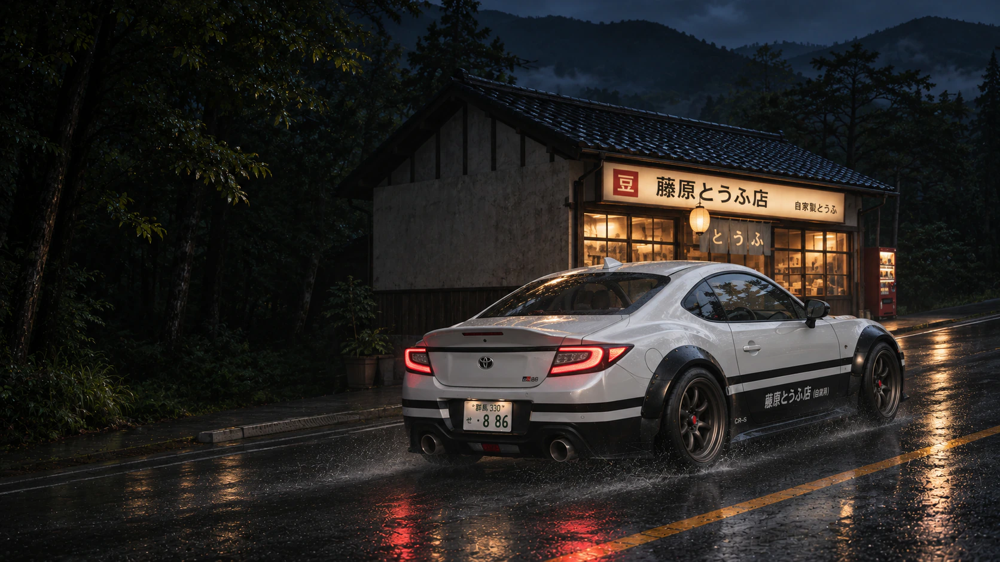
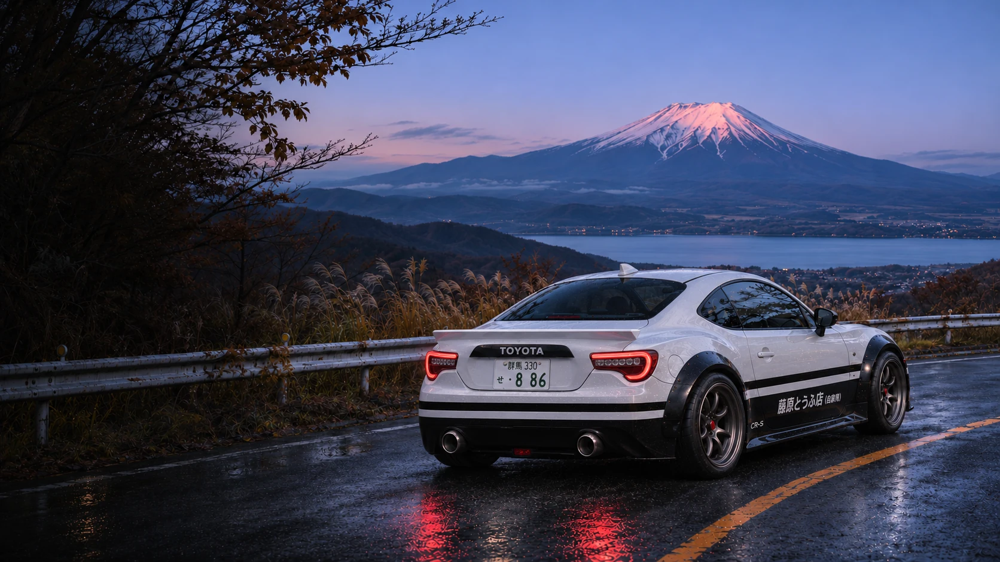
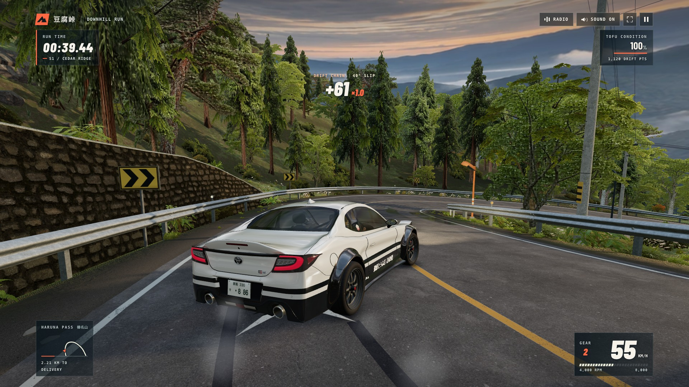
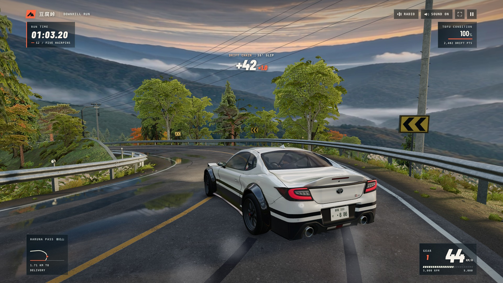
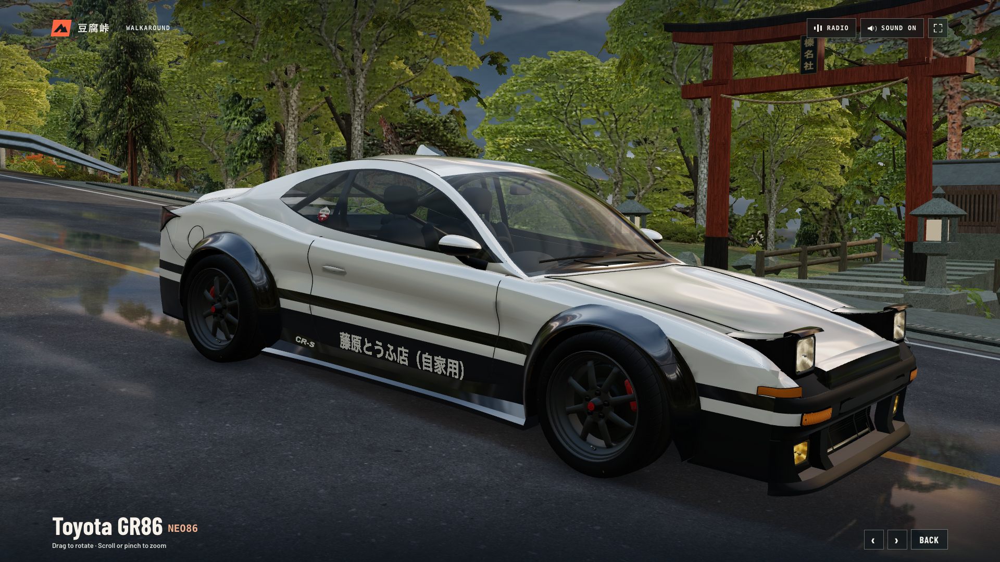

# Tofu Touge

A Three.js drift game on two Japanese mountain passes. Choose the 1983 Toyota Sprinter Trueno AE86 or the modern NEO86 widebody. Deliver tofu through the wet cedar forest of Haruna or along a ridge above Lake Yamanaka with Mount Fuji across the water. Each pass has an uphill and downhill run, and each car keeps its own records.

**[Play in your browser](https://bhaisley.github.io/tofu-touge/)** · [Download the offline game](https://github.com/bhaisley/tofu-touge/releases/latest/download/Tofu-Touge.html) · [Watch the full downhill run](https://bhaisley.github.io/tofu-touge/docs/media/haruna-full-run.mp4)

## Sprinter Trueno AE86



The garage’s second car is the Japanese-market 1983 GT APEX three-door. Its 4.205 m body sits on a 2.400 m wheelbase. The panda paint, eight-spoke wheels and Fujiwara Tofu Shop lettering recall the delivery car from *Initial D*. The headlamps retract for daylight and rise on the night runs. [Drive the AE86 at Haruna](https://bhaisley.github.io/tofu-touge/dist/?stage=downhill&car=ae86) · [Toyota’s vehicle specifications](https://www.toyota-global.com/company/history_of_toyota/75years/vehicle_lineage/car/id60009032/index.html)

The naturally aspirated 1,587 cc 4A-GEU sends power to the rear axle through five forward ratios. Its intake opens up as revs rise. This 17-second recording from the game mixer takes it from idle through acceleration, two shifts and a throttle lift. [Hear the Trueno](https://bhaisley.github.io/tofu-touge/playtest/trueno-engine.m4a) · [Toyota’s 1983 engine description](https://global.toyota/en/detail/7739043)

In this seven-second gameplay clip, the AE86 reaches 30.7° of slip on a wet Haruna hairpin and banks 706 drift points with its cargo intact. The recording uses the chase camera, scripted gamepad inputs and live engine and tire mix. [Watch the drift](https://bhaisley.github.io/tofu-touge/playtest/trueno-hairpin.mp4) · [Model dimensions and build references](docs/ae86.md)

## Mikuni Pass



Descend from Myojin ridge past the Panorama-dai overlook to the Hirano switchbacks in late afternoon. For the return run, leave Hirano before sunrise and climb 186 m with the headlights on. Both deliveries follow the same 4.60 km of asphalt. The bends are original to the game. The length, elevation change and location of the overlook follow Yamanashi’s published cycling profile. [Drive the descent](https://bhaisley.github.io/tofu-touge/dist/?stage=fuji-downhill) · [Drive the ascent](https://bhaisley.github.io/tofu-touge/dist/?stage=fuji-uphill) · [Yamanashi course profile](https://www.yamanashi-kankou.jp/zenryoku/hill-climb/hyakusaka/course/921/index.html)

## Haruna after dark



Choose **Haruna Pass** and **Uphill · Night** to leave Fujiwara Tofu and climb 257 m through Valley Climb, Five Hairpins and Cedar Summit. The dawn descent returns to the shop along the same 3.11 km of wet switchbacks. This frame is from a complete night delivery using the standard gamepad inputs. [Drive Haruna at dawn](https://bhaisley.github.io/tofu-touge/dist/?stage=downhill) · [Drive Haruna at night](https://bhaisley.github.io/tofu-touge/dist/?stage=uphill)

## Promotional concept


An original illustrated poster for the Haruna Downhill release.

## Full downhill run

[](https://bhaisley.github.io/tofu-touge/docs/media/haruna-full-run.mp4)

In the original v0.1.0 downhill release, the delivery clock stops at **02:21.04** with **6,732 drift points** and **100% tofu condition**. The peak slide reaches **40.1°**. A scripted driver used the standard analog gamepad controls for the entire run, from the starting grid through all three sectors. The stereo audio comes from the game, including the engine, tires and the radio’s transition from *Daybreak Signal* to *Kōri no Hibana*.

[Watch in your browser · 720p60](https://bhaisley.github.io/tofu-touge/docs/media/haruna-full-run.mp4) · [Download the full-resolution video · 1080p60](https://github.com/bhaisley/tofu-touge/releases/download/v0.1.0/Haruna-Full-Run.mp4) · [Repository copy](docs/media/haruna-full-run.mp4)

## Screenshots

| Haruna · Night | Mikuni · Blue hour |
| --- | --- |
|  |  |

| Cedar ridge · 40° of slip | Five hairpins · countersteering into the bend |
| --- | --- |
|  |  |
| **NEO86 · walkaround** | **Tofu delivered · all three sector splits** |
|  |  |

The four Haruna gameplay frames in the second table come directly from v0.1.0. [Original title screen](docs/media/haruna-title.png) · [Capture details](MEDIA_PROVENANCE.json)

## Play

Open the browser edition or download **Tofu-Touge.html** and open it in a browser with WebGL enabled. The single-file edition embeds the renderer, models, art, fonts, soundtrack, and effects for offline play. [Play online](https://bhaisley.github.io/tofu-touge/) · [Download the standalone game](https://github.com/bhaisley/tofu-touge/releases/latest/download/Tofu-Touge.html)

Open **Garage** on the title screen and choose **AE86 · Trueno** or **GR86 · NEO86**. You can also switch cars with the arrow beside the garage tile. Your selection carries into the race and is remembered on your next visit. On Mikuni the car parks by Panorama-dai. Drag or use the arrow keys to orbit, and scroll, pinch, or press + / − to zoom. The right stick rotates the view on a standard gamepad. **Back** or Escape returns to the menu. [NEO86 rear and flat spoiler](playtest/neo86-kit-rear.jpg) · [Rear glass close-up](playtest/neo86-rear-glass.jpg) · [Walkaround photographs](playtest/neo86-walkaround.jpg)

While driving in **Chase** or **Low Chase**, hold the left mouse button and drag to look around the car. Drag sideways for a full orbit and vertically to change the viewing angle. Release the button to ease back behind the car. You can keep steering, accelerating and drifting throughout.

Open **Radio** to audition any track and select the music for your run. The five songs play in sequence. Press **N** or **D-pad right** to skip while driving. Opening the radio mid-run pauses the car and keeps the music playing. **Radio** and **Pause** both have separate **Sound effects** and **Music** sliders. The game remembers your levels, selected course and song between visits.

Watch the GR86 drift through a Haruna hairpin with **Kōri no Hibana** on the radio. The seven-second chase-camera recording includes the engine, tire screech and music as mixed by the game. [Watch the hairpin](playtest/haruna-hairpin.mp4) · [Hear the engine in isolation](playtest/ae86-engine-run.m4a)

The pass is set just after rain. Water collects between drying tire tracks, while sugi, maple and silvergrass line the bends. [Earlier wheel, glass and meadow comparison](playtest/haruna-detail-update.jpg) · [Earlier environment comparison](playtest/haruna-environment.jpg)

For the editable static edition, run the following command from this directory and open the loopback address the server prints.

```sh
python3 -m http.server 8477 --bind 127.0.0.1 --directory dist
```

Use WASD or the arrow keys to drive. Brake before a hairpin, turn in and pull Space briefly to lock the rear wheels. Release Space, feed in throttle and tap opposite steer to balance the slide. The drift readout shows your body slip angle. Straightening up banks the chain. Barrier hits cost tofu condition and break a live chain. Reaching zero condition ends the delivery. R recovers the car with a three-second penalty, C cycles cameras, M toggles sound, and Escape pauses.

The Controls screen lists bindings for standard gamepads and touchscreens. On a controller, use D-pad up or down to select the mountain and left or right to select the direction. On a phone, the steering and pedals accept simultaneous touches. In portrait the handbrake sits above the brake, leaving room to keep a thumb on the accelerator. The results show all three sector splits. The game saves personal bests for each pass and direction in the browser when local storage is available.

## Build and assets

The editable game lives in `dist/` and can be served by a static HTTP server. Rebuild the offline edition with `python3 tools/standalone.py`. Three.js r160.1 and the Barlow fonts ship with their licenses in `dist/vendor/` and `dist/assets/fonts/`.

The GR86 and the pass are authored in JavaScript. Toyota publishes a 2,575 mm wheelbase, a 1,550 mm rear track and a roof height of 1,280 mm, or 1,310 mm including the antenna. Its rear and rear-quarter photographs guided the shape of the cabin. Result Japan exhibited its NEO86 on a 2014 ZN6. The game adapts its pop-up headlamps, overfenders, apron, trunk spoiler and eight-spoke wheels to the later GR86, with a right-hand-drive interior and tofu-shop lettering on the driver’s door. [Toyota specifications](https://global.toyota/en/newsroom/toyota/36247827.html) · [Toyota exterior photographs](https://media.toyota.co.uk/images/gr86-exterior-static-2022-current/) · [Result Japan’s NEO86 gallery](https://result-japan.net/items/696f0367286e6359c84cba20) · [Tokyo Auto Salon exhibit](https://www.tokyoautosalon.jp/2026/clist02/91001)

The white NEO86 show car guided the short deck, flat upper blade, hooked tail lamps and black TOYOTA garnish. In the model the central 1.21 m of the blade shares one height, and the end bevels meet the quarters. The center stop lamp sits under the lip. A single high plate mount takes the black NEO86 exhibition plate in the garage and the Gunma registration during deliveries. The black apron wraps behind both rear wheels around twin exhaust tips. Trees and sky openings reflect across the pearl body and glossy black trim as the car turns. [Matched in-game rear views](playtest/neo86-kit-rear.jpg)

The modeled rear glass measures about 1.21 m at its widest. The straight line from the center of the roof edge to the center of the sill is 0.75 m long and drops 0.19 m. The target outline comes from photographs. Toyota’s stock rear track supplied the scale for the straight-rear view, and a high rear-quarter view located the glass relative to the wheels. The lower edge bows toward the trunk and its corners meet the painted pillars. The cage diagonal clears the back of the driver’s headrest by 74 mm. The game’s widened wheel tracks measure 1.756 m front and 1.798 m rear. With the wheels straight, the sidewalls sit about 11 mm inside the front flare crowns and 13 mm inside the rear crowns. [Toyota Japan catalog, rear-quarter view](https://toyota.jp/pages/contents/request/webcatalog/86/gr86_main.pdf#page=6) · [Rear glass comparison](playtest/neo86-rear-glass.jpg) · [Wheel detail](playtest/haruna-detail-update.jpg)

The soundtrack was composed and rendered locally with YuE2. The radio crossfades on the Web Audio clock and keeps the current song and the next song decoded. All five tracks are included in the offline HTML. [Night Delivery production notes](sound/music/night-delivery.md) · [New tracks, scores and lyrics](sound/music/haruna-radio.md)

| Track | Style | Tempo |
| --- | --- | --- |
| [Night Delivery](dist/assets/music/night-delivery.mp3) | Arcade eurobeat | 150 BPM |
| [Cedar Afterglow](dist/assets/music/cedar-afterglow.mp3) | Flute-led Japanese jazz-hop | 92 BPM |
| [Rain on the Engawa](dist/assets/music/rain-on-the-engawa.mp3) | Electric-piano lo-fi hip-hop | 76 BPM |
| [Daybreak Signal](dist/assets/music/daybreak-signal.mp3) | Guitar-led J-pop with an original Japanese chorus | 143 BPM |
| [Kōri no Hibana](dist/assets/music/kori-no-hibana.mp3) | Japanese kawaii metal with a sung refrain and double-kick drums | 180 BPM |

Each car has six original SuperCollider engine recordings. The cars share tire, road and event sounds. On the turbocharged NEO86, pressure builds with sustained throttle and engine speed, up to 0.35 bar. Lifting or upshifting under boost vents the blow-off valve. A hot exhaust can pop on the throttle cut, with a brief flame at each outlet. Front-tire scrub, rear breakaway and handbrake lock have separate voices. The editable synthesis code is in `sound/sfx/`. [Artwork and material credits](art-direction.md)

The turbo whistle rises as boost builds, then settles under the engine at sustained throttle. Hear the same bonnet-view acceleration twice at matched engine and master levels. The original mix plays first and the revised mix begins at 8.6 seconds. [Hear the comparison](https://bhaisley.github.io/tofu-touge/playtest/turbo-bonnet-comparison.m4a)

The engine uses original synthesized exhaust recordings at 960, 2,400, 3,600 and 6,600 RPM, with separate intake and closed-throttle sounds. All six follow the same four-cylinder firing cycle through shifts. The exterior exhaust was tuned against the parked and departing car in noplansco’s mountain run. The onboard section informed the fuller low mids in bonnet view. Passing a stone retaining wall adds one short reflection on that side of the road. [Parked and pulling away at 0:43](https://www.youtube.com/watch?v=sBC2tZZuXr0&t=43s) · [Onboard at 1:22](https://www.youtube.com/watch?v=sBC2tZZuXr0&t=82s) · [Exterior pass at 1:30](https://www.youtube.com/watch?v=sBC2tZZuXr0&t=90s)

## Handling and chase cameras

The title screen prepares the selected pass in short batches. You can change mountains, open the radio or read the controls while it loads. Switching directions reuses the road and its scenery. Changing mountains releases the previous graphics context. Before a countdown begins, the renderer prepares the shaders, textures and lights for that stage. During a run, shadows, wet asphalt and roadside mirrors use simpler geometry for details too small to resolve in those views. The main camera draws the selected car at full detail.

The chassis runs at 120 Hz. The front and rear tires share their available grip between cornering and longitudinal force. Braking shifts load forward, power goes to the rear axle, and a short rear lock can initiate a drift. Both rear contact patches lay rubber in proportion to slip. Hot tires leave a smoke plume on drier asphalt and throw more spray across standing water. The cameras, wheels and tire trails share an interpolated pose.

Run `node tools/check-handling.cjs` to reproduce braking, throttle oversteer, a keyboard and an analog hairpin, a complete delivery, and a glancing barrier hit. Run `node tools/check-presentation.cjs` to check motion between physics ticks across several display rates and a recovery. Run `node sound/sfx/check-mix.cjs` to check tire levels, engine response, the camera perspectives and wall reflections.

Run `node tools/check-chase-orbit.cjs` to check mouse capture, release and camera clearance during a slide in either direction of the pass.

Run `node tools/check-forest.cjs` to verify vegetation placement and visibility on both passes. With Playwright and Chromium, `node tools/check-startup.cjs` exercises both starts, cancellation and recovery after WebGL context loss. Pass it the served game URL to also check the menu with a delayed graphics download.

With Playwright and Chromium installed, `node tools/check-radio.cjs` exercises the offline song picker, measures audible output from all five tracks, and checks crossfades, rapid skips, pause and resume, and the saved selection. `node tools/check-touch.cjs` drives both stages and checks phone layouts, simultaneous touches, legacy records and the independent volume controls. Set `CHROME_BIN` to use an existing Chromium installation.

Run `node tools/check-backlight.cjs` to measure the glass, cage clearance and flat spoiler, trace the two-tone finish behind both wheels, verify the plate mounting and check all three brake lights in both chase cameras. Run `node tools/check-passes.cjs` to check both Mikuni starts, the Hirano skyline and map switching. Run `node tools/check-garage.cjs` to exercise car selection, persistence, restarting a run and graphics-context recovery.

## Production decisions

This build has two selectable cars, two mountain passes, single-player delivery time attack, and accessible arcade handling. For a larger production, the decisions that change the work most are the minimum hardware and frame-rate target, intended controller or wheel support, handling reference, and number of passes, cars, rival drivers, and campaign events. A dimensioned scan or CAD model of the conversion would support a more exact exterior. Vehicle-specific recordings under load would support a future modern GR86 sound tune. Driver playtests on target hardware would help refine handling. Commercial planning should include the intended Toyota and Initial D branding permissions and review of the music model’s commercial terms.
