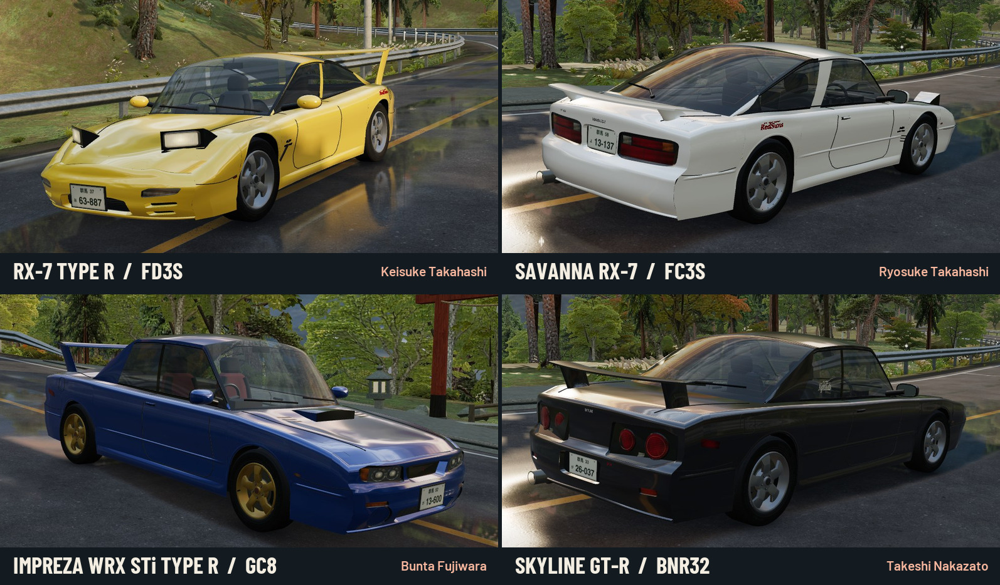

# Akina Rivals

Four cars from *Initial D* joined Tofu Touge in v0.7.0. Netorabo’s Japanese readers gave the FD3S and FC3S 45 votes each, the AE86 36, the GC8 35 and the BNR32 32. With Takumi’s Trueno already in the garage, the other four became the release lineup. Car Sensor’s separate survey of 100 fans also placed the R32, FD and Impreza among its favorites. [Netorabo’s complete ranking](https://nlab.itmedia.co.jp/research/articles/2098470/5/) · [Car Sensor’s survey](https://www.carsensor.net/contents/editor/category_1585/_66388.html)

## Chassis and engines

The table lists Japanese road-car specifications. Overall width excludes the mirrors. The game uses the wheelbase and both track widths to locate the wheel hubs, the body envelope to scale the coachwork, and a 65 kg driver in addition to curb mass.

| Road car | Length × width × height (mm) | Wheelbase (mm) | Track, front / rear (mm) | Curb mass | Factory engine output |
| --- | --- | --- | --- | --- | --- |
| Mazda ɛ̃fini RX-7 Type R FD3S | 4,295 × 1,760 × 1,230 | 2,425 | 1,460 / 1,460 | 1,260 kg | 255 PS, 13B-REW sequential twin-turbo rotary |
| Mazda Savanna RX-7 ∞ III FC3S | 4,335 × 1,690 × 1,270 | 2,430 | 1,450 / 1,440 | 1,230 kg | 215 PS, 13B single-turbo rotary |
| Subaru Impreza WRX Type R STi Version V GC8 | 4,350 × 1,690 × 1,405 | 2,520 | 1,470 / 1,460 | 1,260 kg | 280 PS, 1,994 cc EJ20 turbo flat-four |
| Nissan Skyline GT-R V-spec II BNR32 | 4,545 × 1,755 × 1,355 | 2,615 | 1,480 / 1,480 | 1,500 kg | 280 PS, 2,568 cc RB26DETT twin-turbo inline-six |

The FD, blue two-door Subaru and V-spec II use Japanese trim-specific catalogue dimensions. The FC follows the late Savanna body and the period ∞ III specification. [Mazda Type R catalogue](https://gazoo.com/catalog/maker/MAZDA/EFINI_RX7/199112/2501590/) · [Savanna catalogue](https://www.carsensor.net/catalog/mazda/savanna_rx-7/F001/M002G009/) · [Period Mazda ∞ brochures](https://minkara.carview.co.jp/userid/300038/car/194396/921600/photo.aspx) · [Subaru Type R catalogue](https://gazoo.com/catalog/maker/SUBARU/IMPREZA/199211/4501985/) · [Nissan V-spec II catalogue](https://gazoo.com/catalog/maker/NISSAN/SKYLINE/199308/1501403/)

## Character builds

**Keisuke’s FD3S** follows his yellow volume-one RX-7. A tall body-color wing rises above the curved hatch and smoked tail panel. The front air dam has paired outer ducts, and the RedSuns markings sit above the rear wheels. The game uses 17-inch silver five-spokes, working pop-ups and a change in the torque curve as the secondary turbo comes in. [Aoshima’s volume-one FD](https://www.aoshima-bk.co.jp/en/product/4905083056219/) · [Mazda’s third-generation RX-7 history](https://www2.mazda.com/en/100th/cars/detail_025_rx7.html)

**Ryosuke’s FC3S** follows his white volume-five Akina battle car. The bonnet duct, rectangular pop-ups, offset plate, dished wheels and low deck spoiler distinguish it from his brother’s FD. Its single-turbo engine develops less power, and the rear suspension adds a small load-dependent toe change. [Aoshima’s Akina battle FC](https://www.aoshima-bk.co.jp/en/product/4905083062494/) · [Mazda’s rotary history and engineering notes](https://filecache.mediaroom.com/mr5mr_mazdaca/210703/download/Mazda_Rotary%20Press_Information%202017.pdf)

**Bunta’s GC8** uses the narrow two-door shell, a raised intake for the top-mounted intercooler, paired bonnet vents, round fog covers, gold five-spokes and a high rear wing. Its short five-speed and rear-biased center differential make it the easier of the two AWD cars to pull out of a tight bend. The game starts at 35% front drive and increases coupling as grip falls. [Fujimi’s Fujiwara Impreza](https://www.fujimimokei.com/item/items/4968728183817/sp/) · [Type R drivetrain registry entry](https://www.rover.infrastructure.gov.au/PublishedApprovals/SEVDetails/?id=bcc18447-884b-ec11-a304-fa28e243ca9c)

**Nakazato’s BNR32** has the dark pearl finish, NightKids quarter-window script, NISMO-style twin-vent bumper, black chin, four circular rear lights and a single large exhaust outlet. Its model of ATTESA E-TS feeds up to half of the drive to the front axle in response to traction demand. A small speed-sensitive rear steering angle accompanies the longer, heavier chassis. [Aoshima’s Nakazato GT-R](https://www.aoshima-bk.co.jp/en/product/4905083200438/) · [Nissan’s R32 and its AWD system](https://www.nissan-global.com/EN/HERITAGE_COLLECTION/skyline_gt-r_1989.html)

## Sound and handling

Each engine has six original SuperCollider layers for idle, three loaded engine speeds, closed throttle and induction. The two rotaries fire twice per eccentric-shaft revolution, with different port, collector and turbo resonances. Unequal exhaust arrival times give the Subaru its boxer beat. The RB26 has three firing events per crankshaft revolution and separate manifold branches. Playback follows simulated engine speed and load through a lift, downshift or slide. [Synthesis source](../sound/sfx/render.scd) · [Chassis and torque curves](../dist/js/rivals.js)

The 28-second comparison was recorded from the game’s stereo output at the Haruna grid. Each clip includes idle, full throttle, a gear change and a lift. The FD, FC, Subaru and Nissan start seven seconds apart at the same mix level. [Hear the four engines](https://bhaisley.github.io/tofu-touge/docs/media/akina-engines.m4a)

These are hand-built interpretations of the character cars. Body contours and visible aftermarket shapes were reconstructed from photographs. Modified torque curves, boost, tire grip, chassis inertia and differential response are game tuning estimates. The audio was synthesized for the game.

The following results come from the 120 Hz game simulation. The acceleration test uses the same level, wet straight for every car. The hairpin test applies a short handbrake initiation at Haruna, countersteers, then requires a clean exit and a banked score. Each car also cleared all three sectors on both passes in both directions with full cargo integrity. [Reproduce the driving tests](../tools/check-handling.cjs)

| Car | Standing 0–100 km/h | Braking from 100 km/h | Peak hairpin slip | Banked drift |
| --- | --- | --- | --- | --- |
| FD3S | 4.80 s | 37.38 m | 29.1° | 565 pts |
| FC3S | 5.81 s | 38.25 m | 29.2° | 495 pts |
| GC8 | 4.91 s | 38.12 m | 27.6° | 496 pts |
| BNR32 | 4.53 s | 37.80 m | 28.2° | 736 pts |
